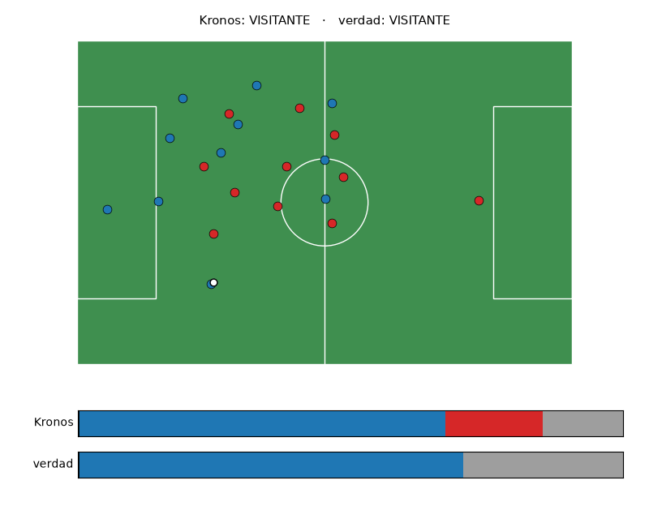
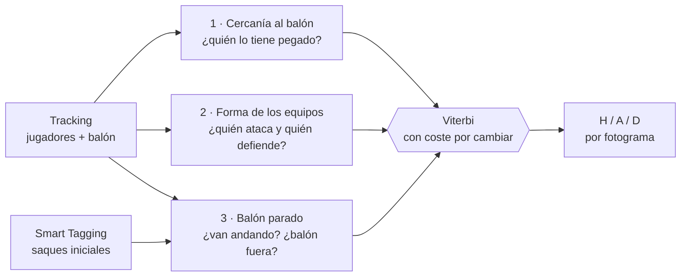
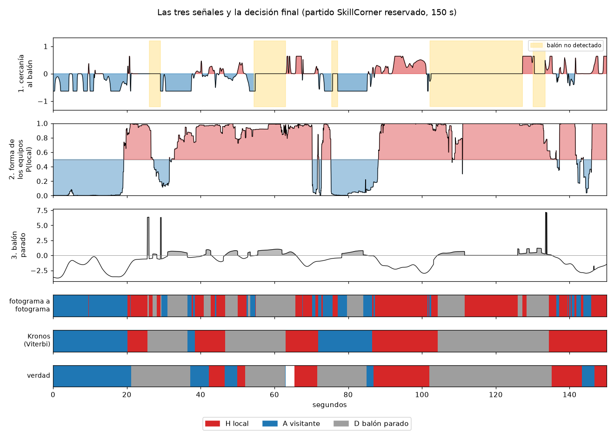
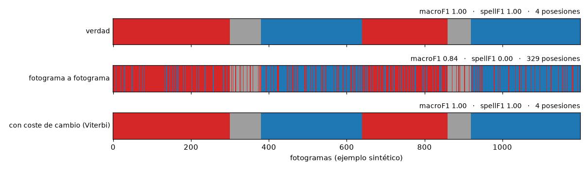
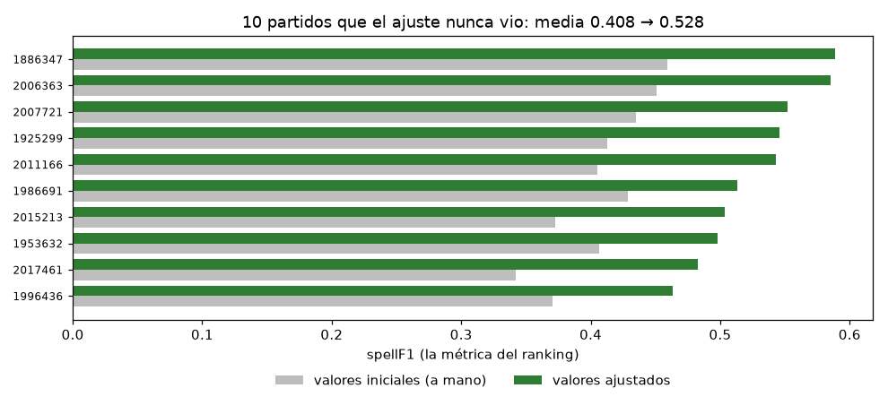

# Kronos · More Than A Hack 2027

**¿Quién tiene el balón?** Respuesta automática, fotograma a fotograma, a partir del tracking de un partido.

Equipo **Kronos** · Initial Challenge de [More Than A Hack 2027](https://landing.mobileworldcapital.com/more-than-a-hack-2027) (MWCapital · Talent Arena), reto de [Metrica Sports](https://github.com/metrica-sports/more-than-a-hack-2027).



*Partido de SkillCorner open data (licencia MIT) que no se usó para ajustar el modelo. Arriba, el
tracking: local en rojo, visitante en azul, balón en blanco cuando se detecta. Abajo, lo que dice
Kronos y la verdad etiquetada. Ninguna imagen de este repositorio sale del partido del reto: las
normas prohíben publicar datos derivados de él.*

> **English summary.** A three-state (home / away / dead ball) hidden Markov model decoded with
> Viterbi. Evidence per frame: ball proximity, a self-supervised team-shape classifier for the 41 %
> of frames without a ball, and dead-ball cues. A switching cost keeps possessions whole, which is
> what `spellF1` rewards. The 12 parameters are tuned **only on other matches** (Metrica sample games
> and SkillCorner open data) and checked on 10 held-out matches: spellF1 **0.408 → 0.528**. No label
> from the challenge match is used for training or tuning. Technical document:
> [`submission/Kronos.md`](submission/Kronos.md).

---

## 1. El problema

Tenemos un partido entero, el Barça-Athletic: 199.319 fotogramas, con la posición de cada jugador y
del balón 25 veces por segundo. Hay que entregar **una etiqueta por fotograma**:

| etiqueta | significado |
|---|---|
| `H` | posesión del equipo local |
| `A` | posesión del visitante |
| `D` | balón parado (fuera, falta, saque…) |

**Las respuestas de ese partido no las tenemos.** Las guarda la organización para ponernos nota.
Hay dos dificultades:

- **El balón no se ve el 41 % del tiempo**, y además en tramos largos (unos 11 s de mediana). El
  tracking es automático y lo pierde en los momentos más disputados.
- La nota no premia acertar fotogramas sueltos, sino **acertar posesiones enteras** (`spellF1`): una
  posesión cortada en dos trozos cuenta como fallo.

## 2. Cómo decide Kronos

Kronos es un "árbitro" automático. Para cada fotograma junta tres pistas y después decide el
partido entero de una vez, no fotograma a fotograma.



1. **Cercanía al balón.** Si un jugador del local está a menos de ~2 m del balón y el rival más
   lejos, apunta a posesión local. Si el balón va por el aire lejos de todos, esta pista calla.
2. **Forma de los equipos.** Sirve cuando no se ve el balón. El equipo que ataca se abre y se
   adelanta; el que defiende se encoge y retrocede. Un clasificador aprende esa diferencia **sin que
   nadie le dé respuestas**: se entrena con los momentos en que el tracking ve claramente quién lleva
   el balón (un jugador pegado a él y el rival lejos). Aprende en una parte del partido y predice la
   otra.
3. **Balón parado.** En las paradas los jugadores van andando, el balón sale del campo o el partido
   aún no ha empezado.

Así se ven las tres pistas en 150 segundos de un partido reservado:



### La clave: cambiar de posesión "cuesta"

Si decidimos cada fotograma por separado (barra *fotograma a fotograma*), la etiqueta parpadea
continuamente: un toque, un rebote, un pase que pasa cerca de un rival… y cada parpadeo crea una
posesión falsa. Kronos usa el **algoritmo de Viterbi**: busca la secuencia de etiquetas que mejor
explica todas las pistas, pagando un precio fijo cada vez que cambia de estado. El resultado
cambia de posesión solo cuando la evidencia es clara y sostenida, que es lo que el reto llama
*posesión controlada*. Además, un balón suelto sigue siendo del último equipo que lo tenía.

Ejemplo sintético con la métrica oficial: casi las mismas etiquetas fotograma a fotograma, pero
nota de posesiones 0 frente a 1.



## 3. Qué significa "ajustar" el modelo

La lógica de arriba la hemos diseñado nosotros, pero tiene **12 números que hay que decidir**: a
cuántos metros cuenta que alguien controla el balón, cuánto cuesta cambiar de posesión, a qué
velocidad media se considera que el juego está parado…

No podemos elegirlos mirando las respuestas del partido del reto, porque no las tenemos. Y aunque
los 5 minutos públicos sí las traen, las normas solo permiten usarlos para comprobar que el fichero
está bien hecho. Así que **practicamos con partidos de otros equipos que sí vienen resueltos**, igual
que se prepara un examen con exámenes de otros años:

| fuente | partidos | de dónde sale la "verdad" |
|---|---|---|
| [Metrica Sports sample data](https://github.com/metrica-sports/sample-data) | 2 | eventos anotados (pases, recuperaciones, saques). Su tracking es limpio, así que lo **estropeamos a propósito** para que se parezca al del reto: huecos largos de balón, jugadores perdidos, ruido |
| [SkillCorner open data](https://github.com/SkillCorner/opendata) | 20 | fases de juego (qué equipo tiene la posesión en cada tramo). Su tracking sale de la retransmisión de TV: **el ruido es real** |

El proceso:

1. Pasamos Kronos por esos partidos con una combinación de los 12 números y lo puntuamos con **el
   mismo script de evaluación oficial** del reto.
2. Probamos unos cientos de combinaciones (búsqueda aleatoria más refinamiento local, con semilla
   fija) y nos quedamos con la mejor.
3. **Diez partidos de SkillCorner se guardan aparte** y solo se puntúan al final, para comprobar que
   el modelo funciona con partidos nuevos y no se ha aprendido de memoria los que ya conocía.



Los valores ajustados ganan en los 10 partidos reservados, uno por uno. Con esos números fijados,
Kronos se pasa por el partido del reto y sale `submission/Kronos.csv`.

## 4. Lo que no hacemos

- **No etiquetamos nada a mano** del partido del reto, ni para entrenar ni para validar.
- **No usamos sus 5 minutos públicos para elegir parámetros**, solo para comprobar que el fichero y
  la alineación están bien.
- **No usamos datos humanos sobre ese partido** (eventos de Opta, StatsBomb, etc.).
- **Los datos del partido no están en este repositorio**: `data/` está en `.gitignore`.

## 5. Resultados

| | spellF1 |
|---|---|
| baseline publicado por la organización (partido completo) | 0.2433 |
| Kronos en 10 partidos externos reservados | **0.528** (media; rango 0.46–0.59) |

La nota real solo la conoce la organización. Sus 5 minutos públicos (17 posesiones) no sirven para
predecirla, como explica [`EVALUATION.md`](EVALUATION.md).

**Qué falta y cómo colaborar:** [`docs/PLAN.md`](docs/PLAN.md).

## 6. Reproducir

Python **3.12** y las versiones exactas de `requirements-kronos.txt` (el clasificador de
scikit-learn puede dar otro resultado con otra versión, y la norma exige el mismo fichero).

```bash
py -3.12 -m venv .venv                                 # Linux/macOS: python3.12 -m venv .venv
.venv/Scripts/activate                                 # Linux/macOS: source .venv/bin/activate
pip install -r requirements-kronos.txt
# datos del reto descomprimidos en data/tactical/ (ver DATA.md)
python -m kronos.run                                   # -> submission/Kronos.csv
python evaluation/validate_submission.py submission/Kronos.csv
python -m kronos.check                                 # regenera y compara byte a byte

# opcional: volver a ajustar y regenerar las figuras
git clone --depth 1 https://github.com/metrica-sports/sample-data external/sample-data
git clone --depth 1 https://github.com/SkillCorner/opendata external/skillcorner     # usa git-lfs
python -m kronos.tune --trials 100                     # -> kronos/params.json
python -m kronos.figures                               # -> docs/img/
```

Determinista: el clasificador y la búsqueda llevan semilla, así que los mismos datos y las mismas
versiones dan el mismo fichero.

## 7. Estructura

| ruta | qué hay |
|---|---|
| `kronos/load.py` | lee el tracking del reto y lo pasa a arrays en metros |
| `kronos/features.py` | cercanía al balón, forma de los equipos, saques iniciales |
| `kronos/model.py` | las tres pistas, el clasificador autoentrenado y Viterbi |
| `kronos/run.py` · `kronos/check.py` | genera la entrega · comprueba que se regenera idéntica |
| `kronos/external.py` · `kronos/skillcorner.py` | partidos externos: carga, "verdad" y ruido |
| `kronos/tune.py` · `kronos/params.json` | ajuste y parámetros elegidos, con su procedencia |
| `kronos/figures.py` · `docs/img/` | las figuras de este README |
| `submission/` | `Kronos.csv` y el documento técnico `Kronos.md` |
| `docs/PLAN.md` | **qué falta**: entrega, mejoras pendientes y normas |
| `docs/CHALLENGE_README.md` y `*.md` de la raíz | documentación original del reto (Metrica) |

## Créditos

- Reto, datos del partido y evaluación: [Metrica Sports](https://github.com/metrica-sports/more-than-a-hack-2027) (código MIT; los datos del partido tienen licencia solo para la competición).
- Partidos externos: [Metrica Sports sample data](https://github.com/metrica-sports/sample-data) y [SkillCorner open data](https://github.com/SkillCorner/opendata) (MIT).
