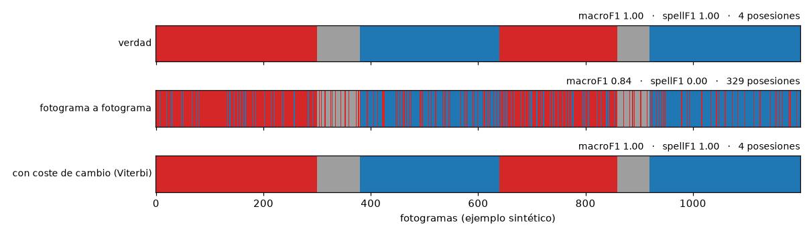
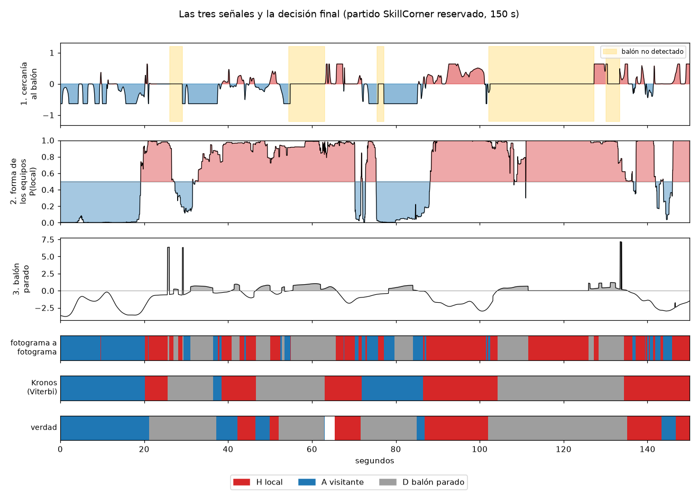
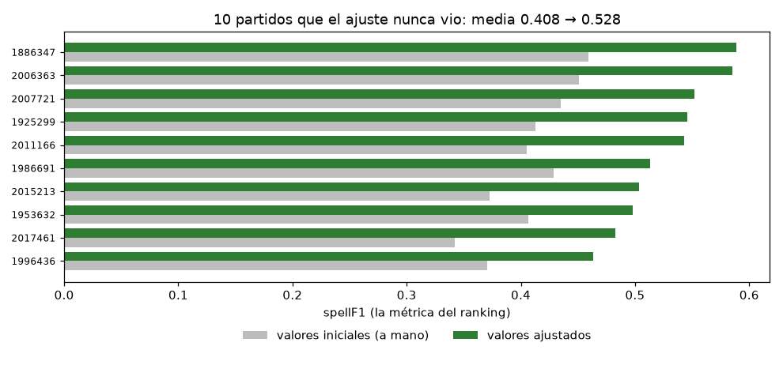

# Kronos — possession from automatic tracking

Team **Kronos** · More Than A Hack 2027 · Initial Challenge

## 1. Approach

We treat possession as a **sequence-labelling problem with three states** — `H`, `A`, `D` — and
decode each half with **Viterbi** over a hidden Markov model whose transitions carry a fixed cost.
Every frame contributes evidence (log-odds) from the tracking; changing state costs a constant.
The decoder therefore keeps a label until the evidence for another one outweighs the cost of
switching, which is exactly the behaviour the definition asks for:

- a *controlled* possession change needs sustained evidence, not one touch or a deflection;
- while the ball is loose or contested the evidence is weak, so possession stays with the last team;
- the output has few, long possessions, which is what `spellF1` rewards.

Why this rather than a per-frame classifier plus smoothing: smoothing windows trade boundary
precision for fewer flickers (the baselines show it), whereas a switching cost removes flicker
without blurring the boundaries of a real change. It is also transparent: every constant has a
physical meaning.



*Synthetic example scored with the official metric: almost the same per-frame labels, but spellF1
0 without a switching cost and 1 with it.*

## 2. Evidence

**Ball proximity (H vs A).** For each frame, the nearest tracked player of each team to the ball
(gaps in the ball track of up to 8 frames are linearly interpolated). The evidence is the distance
advantage of one team, clipped, and weighted by how close the nearest player is
(`exp(-(d - r)/s)` beyond a control radius `r`), so a ball in flight far from everyone says nothing.

**Team shape (H vs A), self-supervised.** The ball is missing on ~41 % of graded frames, and in long
stretches (median ~11 s), so proximity alone leaves long blind spans. A gradient-boosted classifier
predicts "home in possession" from collective features of both teams (centroid, spread, most
advanced / deepest player, mean speed, centroid velocity; in a frame where home always attacks +x).
It is trained on **pseudo-labels produced by the tracking itself** — frames where one team is within
1 m of a tracked ball and the other is more than 3 m away during live play — and **cross-fitted by
half** (trained on one half, applied to the other). No human decides any label (RULES.md allows
algorithmic pseudo-labels on the provided game).

**Dead ball (D vs alive).** Mean player speed (players walk during stoppages), a fast-moving ball in
the last two seconds (play is live), the ball outside the pitch lines, and the Smart Tagging's
`Kick Off (Start)` tags (everything from the start of a graded half to its kickoff is dead).



*150 s of a held-out SkillCorner match: the three signals and Kronos' decision against the labels.
No figure in this document comes from the challenge match.*

## 3. Assets used and dropped

| asset | use |
|---|---|
| tactical ATD | all of the above |
| Smart Tagging | kickoff tags only. `GOALS` intervals span minutes around a goal, so they do not locate the stoppage; phase tags were not used in this version |
| homography, videos | not used (no detection or tracking of our own) |
| broadcast ATD | not used |

## 4. Training and tuning data

- **No labels on the provided game**, from anyone. The public 5-minute ground truth was used only
  to check that the pipeline is correct (alignment, file format), never to choose parameters.
- **Parameter tuning on other games only**, maximising the official `spellF1` by seeded random
  search plus local refinement (`kronos/tune.py`); values and provenance in `kronos/params.json`.
  Two public sources:
  - **Metrica Sports sample games 1–2** (github.com/metrica-sports/sample-data; events annotated
    by Metrica). Events → frame labels with the challenge's semantics (`kronos/external.py`:
    owning team from on-ball events, dead from ball-out / foul until the restart). Their clean
    tracking is **degraded** to resemble the automatic tracking (ball dropouts in long runs
    matching the challenge's statistics, player dropouts, position noise), two seeds each.
  - **SkillCorner open data**, 20 A-League 2024-25 matches (github.com/SkillCorner/opendata),
    broadcast tracking whose ball is detected on ~60 % of frames — real, not simulated, noise.
    Labels from SkillCorner's phases of play: team in possession per phase, gaps between phases
    as stoppages (`kronos/skillcorner.py`; 10 fps resampled to 25 fps).
  - 10 SkillCorner matches + the Metrica games are used for tuning; **the other 10 SkillCorner
    matches are held out** and only scored at the end.

  | | tuning set (14) | **held-out SkillCorner (10)** |
  |---|---|---|
  | hand-set priors | 0.389 | 0.408 |
  | tuned on Metrica only | 0.452 | 0.438 |
  | **tuned on Metrica + SkillCorner (submitted)** | **0.502** | **0.528** |

  The submitted parameters beat the Metrica-only ones on each of the 10 held-out matches. They
  are worse on the two degraded Metrica games (≈0.38 vs 0.435); we prefer the real broadcast noise
  and the unseen matches as the better proxy.

- The team-shape classifier is trained only on algorithmic pseudo-labels (section 2).



*spellF1 on the 10 held-out SkillCorner matches, priors vs tuned parameters.*

## 5. Possession rules implemented

- Possession changes only when the other team shows sustained proximity control (cost
  `switch_team`); a single touch, a deflection or an aerial duel without follow-up does not
  outweigh it.
- Loose and contested balls: weak evidence → the previous possession continues.
- Restarts: after a `D` stretch any team may restart; nothing ties the restart to the previous owner.
- Dead ball before each half's kickoff is forced from the Smart Tagging.

## 6. Limitations

- External tuning data come from different matches, leagues, cameras and tracking quality, and
  their labels come from events or phases of play rather than from corrected tracking, so the
  exact boundary conventions differ from the challenge's ground truth.
- Throw-ins and short stoppages with high player speed are hard to separate from live play.
- Long ball dropouts during transitions: the shape classifier reacts with a delay.
- Next steps: use the video/homography to recover the ball where the tracking loses it; use Smart
  Tagging phase tags (team-tagged phases) as extra evidence; per-player control persistence.

## 7. Reproduction

Python **3.12** with the exact versions in `requirements-kronos.txt` (the scikit-learn classifier
may give different output under other versions).

```bash
python3.12 -m venv .venv && source .venv/bin/activate   # Windows: py -3.12 -m venv .venv; .venv/Scripts/activate
pip install -r requirements-kronos.txt
# data unpacked into data/tactical/ as described in DATA.md
python -m kronos.run                      # -> submission/Kronos.csv
python evaluation/validate_submission.py submission/Kronos.csv
python -m kronos.check                    # regenerates and compares byte for byte with the committed file
# optional: re-tune on the external games
git clone --depth 1 https://github.com/metrica-sports/sample-data external/sample-data
git clone --depth 1 https://github.com/SkillCorner/opendata external/skillcorner   # git-lfs
python -m kronos.tune --trials 100        # -> kronos/params.json
python -m kronos.figures                  # -> docs/img/
```

Deterministic: the classifier and the search are seeded; the same data and the same package
versions produce the same file.
